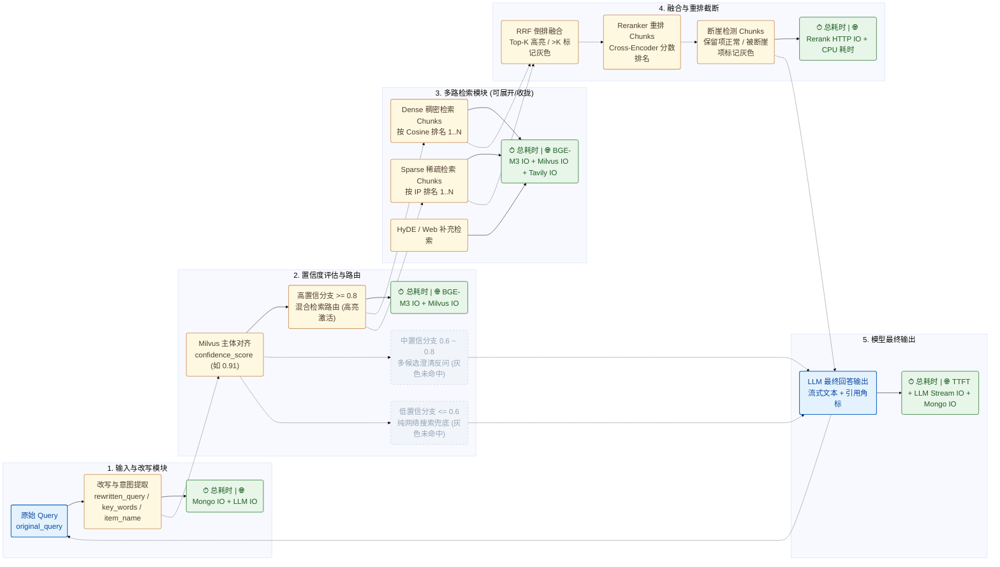

# RAG 链路观测层（Observer）详尽实施计划

> **目标概述**：在现有 8001 端口的一体化服务（`web/api/main_service.py` + `web/page/`）中，新增独立的 **RAG 链路观测层（Observer）**，挂载于前端左侧边栏第三栏。通过非侵入式/轻侵入式埋点收集每次查询的完整生命周期数据，按 `yy-mm-dd:hh` 文件夹归档落盘，并在前端以**虚线连接的模块化流图 + 可展开/收拢的排名切片列表 + 灰化淘汰态 + 模块底部网络 IO 耗时铭牌**形式完整复盘单次 Trace。

---

## 一、 现状调研与核心差异点分析

结合当前代码库（`atguigu/query_process/` 与 `web/`），现有流水线与观测层需求存在以下 5 个关键技术对齐点：

1. **`key_words` 字段来源对齐**
   - **现状**：`NodeItemNameConfirm` 中的 `ItemNameExtractResult`（Pydantic Schema）目前仅提取 `rewritten_query` 和 `item_names`，未输出 `key_words`。
   - **方案**：在 `ItemNameExtractResult` 中扩展 `key_words: list[str]` 字段（提取查询核心关键词），同时记录 BGE-M3 稀疏向量（Sparse）的高权重词项作为补充兜底，确保 `key_words` 稳定产出且不影响原有主体识别准确率。

2. **置信度分数与三路分支路由（灰化未命中分支）**
   - **现状**：`NodeItemNameConfirm.align_item_names_by_score` 根据 Milvus `item_name_collection` 混合检索的 `distance`（相似度得分）执行三级判定：
     - **高置信度（`score >= 0.8` 或唯一中置信候选）**：路由至并行检索分支（本地向量检索 + HyDE 检索 + 网络搜索 -> RRF -> Rerank -> 答案生成）。
     - **中置信度多候选（`0.6 < score < 0.8` 且候选数 `> 1`）**：拼装澄清反问话术，直接路由至 `NodeAnswerOutput` 返回候选按钮。
     - **低置信度（`score <= 0.6` 或无匹配，`is_low_confidence=True`）**：仅路由至 `NodeWebSearchMcp` -> `NodeAnswerOutput`。
   - **方案**：在 Trace 中完整记录最高匹配置信度 `confidence_score`、全部候选物料得分列表及实际命中的路由枚举 `route_taken`（`high_hybrid` / `medium_clarify` / `low_web_only`）。前端渲染全部三条虚线路由分支，**实际执行的路由线高亮着色，其余两条未命中路由线及未执行节点整体置灰**。

3. **Dense 检索与 Sparse 检索独立排名展示**
   - **现状**：`NodeSearchEmbedding` 调用 `weighted_hybrid_search`，将 `dense`（权重 0.8）与 `sparse`（权重 0.2）请求合并发给 Milvus `hybrid_search`，Milvus 内部直接返回加权融合后的结果，未单独暴露 Dense 单路排名和 Sparse 单路排名。
   - **方案**：`get_bgem3_embedding` 已经一次性返回了 `vecs["dense"][0]` 与 `vecs["sparse"][0]`（无需额外调用模型推理）。在 `milvus_client_tool.py` 中新增双路明细检索辅助函数（复用全局 `MilvusClient` 连接池，通过线程池并发执行 `dense` 单路 `search` 与 `sparse` 单路 `search`，本地 Milvus 耗时仅 ~10ms），从而在 Trace 中精确捕获 **Dense Top-K Chunks（含 Cosine 分数与排名）** 与 **Sparse Top-K Chunks（含 IP 分数与排名）**，同时保留 HyDE 与 Web 检索结果。

4. **RRF Top-K 截断标记与断崖检测（Cliff Detection）灰化标记**
   - **现状**：
     - `NodeRrf` 将多路切片融合排序后输出全部去重切片（最多 20 条），未显式区分 Top-K（如 `top_k = 10`）与尾部淘汰项。
     - `NodeRerank.cliff_detection` 在 `MIN_LEN=3` 到 `MAX_LEN=10` 之间检测相邻切片得分差（`abs_gap > 0.25` 或 `ratio_gap > 0.1`），直接返回截断后的切片 `rerank_merge_docs[:i+1]`，丢弃了被断崖淘汰的切片及差值明细。
   - **方案**：
     - **RRF 模块**：记录完整融合列表，标记排名 `rank <= rrf_top_k`（默认 10）为 `is_topk = True`，排在 `top_k` 之后的切片标记 `is_topk = False`（前端渲染为灰色淘汰态）。
     - **Reranker 与断崖检测模块**：完整保留 Cross-Encoder 重排后的全部切片列表，逐项计算并记录与上一名的 `abs_gap` 和 `ratio_gap`；在断崖截断点之后的所有切片标记 `is_cliff_dropped = True` 及 `drop_reason`（`abs_gap > 0.25` / `ratio_gap > 0.1` / `rank > MAX_LEN`），前端按排名展示并在断崖处绘制分割线，被断崖淘汰的 Chunks 标记为灰色。

5. **模块级与网络 IO 耗时采集（方格底部铭牌）**
   - **现状**：`task_utils.py` 仅存在粗粒度节点耗时字典，缺少内部子步骤及网络 IO（BGE-M3 远程 HTTP、Milvus RPC、MongoDB 读写、Tavily API、DashScope/TEI Rerank、LLM 首字延迟 TTFT 与流式生成）的精细耗时。
   - **方案**：设计上下文计时器 `SpanTimer`，在每个模块内部包裹计算逻辑与网络 IO 调用，将 **`total_ms`（模块总耗时）** 与 **`io_breakdown`（网络 IO 分项耗时）** 记录到 Trace 模型中，前端统一渲染在每个模块方格的正下方。

---

## 二、 系统架构与目录解耦设计

遵循“预先定义 infrastructure、schema 和数据模型，解耦观测层与核心业务层”的原则，目录规划如下：

```text
kb_0515/
├── observer/
│   ├── __init__.py
│   ├── plan.md                  # 本实施计划文档
│   ├── schemas.py               # Pydantic 数据模型定义（Trace 完整结构、Chunk 项、耗时统计等）
│   ├── collector.py             # TraceCollector 上下文收集器与 SpanTimer 计时器（线程/协程安全）
│   ├── storage.py               # 异步文件落盘与读取基础设施（按 yy-mm-dd:hh 归档管理）
│   ├── router.py                # FastAPI 路由模块（挂载至 8001 主服务 /api/observer/*）
│   └── traces/                  # Trace 归档根目录（自动创建）
│       └── 26-10-24:21/         # 按 yy-mm-dd:hh 命名的归类文件夹
│           └── 20261024_210512_a1b2c3d4.json
├── atguigu/
│   ├── query_process/           # 轻量化埋点接入 TraceCollector
│   └── tool/
│       └── milvus_client_tool.py # 补充 dense/sparse 独立检索能力并复用连接池
└── web/
    ├── api/
    │   └── main_service.py      # 注册 observer.router（同享 8001 端口）
    └── page/
        ├── index.html           # 侧边栏新增第 3 栏“🔍 链路观测”及主画布容器
        ├── css/
        │   └── style.css        # 新增 Trace 流图、虚线连接、灰化卡片、耗时铭牌样式
        └── js/
            └── app.js           # 新增 Trace 目录树加载、画布渲染、Chunk 展开收拢逻辑
```

---

## 三、 核心数据流与前端可视化拓扑（Mermaid）



---

## 四、 数据模型与 Schema 设计（`observer/schemas.py`）

使用 Pydantic v2 定义强类型数据模型，确保前后端契约清晰、易于维护：

### 4.1 基础计时与网络 IO 模型 (`ModuleTiming` & `IOBreakdownItem`)
```python
class IOBreakdownItem(BaseModel):
    """职责: 记录单个网络IO或子步骤的耗时明细"""
    name: str = Field(..., description="IO操作名称, 如 BGE-M3 Embedding HTTP / Milvus Dense Search")
    io_type: str = Field(default="network", description="类型: network | db | llm | cpu")
    duration_ms: float = Field(..., description="耗时(毫秒), 保留1位小数")
    status: str = Field(default="ok", description="状态: ok | timeout | error")

class ModuleTiming(BaseModel):
    """职责: 记录单个模块方格的总耗时与网络IO拆解"""
    started_at: float = Field(default=0.0, description="开始时间戳")
    ended_at: float = Field(default=0.0, description="结束时间戳")
    total_ms: float = Field(default=0.0, description="模块总耗时(毫秒)")
    io_breakdown: list[IOBreakdownItem] = Field(default_factory=list, description="内部网络IO耗时列表")
```

### 4.2 统一切片观测模型 (`TraceChunkItem`)
```python
class TraceChunkItem(BaseModel):
    """职责: 表示检索、RRF、Reranker、断崖检测各阶段中的单个文档切片项"""
    rank: int = Field(..., description="当前阶段内的排名(从1开始)")
    chunk_id: str = Field(default="", description="切片唯一标识")
    file_title: str = Field(default="", description="来源文档标题")
    section_title: str = Field(default="", description="小节标题")
    item_name: str = Field(default="", description="所属商品/主体名称")
    content: str = Field(default="", description="切片正文内容(支持展开/收拢查看)")
    source: str = Field(default="local", description="来源: dense | sparse | hyde | local | web")
    score: float = Field(default=0.0, description="当前阶段主分数(向量相似度 / RRF分数 / Rerank分数)")
    # RRF 专属附加字段
    dense_rank: int | None = Field(default=None, description="在Dense检索中的原始排名")
    sparse_rank: int | None = Field(default=None, description="在Sparse检索中的原始排名")
    hyde_rank: int | None = Field(default=None, description="在HyDE检索中的原始排名")
    is_grayed: bool = Field(default=False, description="是否灰化展示(被挤出TopK或被断崖淘汰)")
    gray_reason: str = Field(default="", description="灰化原因说明, 如 '超出Top-10' 或 '断崖截断: abs_gap=0.31 > 0.25'")
    # 断崖检测专属附加字段
    abs_gap: float | None = Field(default=None, description="与前一名切片的绝对分差")
    ratio_gap: float | None = Field(default=None, description="与前一名切片的相对分差比例")
```

### 4.3 完整单次 Trace 模型 (`RAGTraceRecord`)
```python
class RAGTraceRecord(BaseModel):
    """职责: 完整记录单次RAG查询全链路的所有观测数据"""
    trace_id: str = Field(..., description="唯一追踪ID(与task_id一致)")
    session_id: str = Field(..., description="会话ID")
    folder_hour: str = Field(..., description="归档文件夹名, 格式 yy-mm-dd:hh")
    created_at: str = Field(..., description="ISO格式创建时间")
    total_duration_ms: float = Field(default=0.0, description="端到端总耗时(毫秒)")
    status: str = Field(default="completed", description="执行状态: processing | completed | failed")
    error_message: str = Field(default="", description="异常信息(如有)")

    # 1. Query 理解与改写模块
    query_module: dict = Field(..., description="包含 original_query, rewritten_query, key_words, extracted_item_names, aligned_item_names, timing")

    # 2. 置信度与路由模块
    router_module: dict = Field(..., description="包含 confidence_score, threshold_high(0.8), threshold_low(0.6), matched_candidates, route_taken, routes_status(三条线的激活/灰化状态), timing")

    # 3. 检索模块 (Dense / Sparse / HyDE / Web)
    retrieval_module: dict = Field(..., description="包含 dense_chunks, sparse_chunks, hyde_chunks, web_docs, timing")

    # 4. RRF 倒排融合模块
    rrf_module: dict = Field(..., description="包含 top_k, rrf_chunks(含TopK之内与被挤出TopK标灰的项), timing")

    # 5. Reranker 重排模块
    reranker_module: dict = Field(..., description="包含 reranked_chunks(完整重排排名列表), timing")

    # 6. 断崖检测模块
    cliff_module: dict = Field(..., description="包含 abs_threshold(0.25), ratio_threshold(0.10), min_len(3), max_len(10), cliff_index, chunks(含保留项与被断崖标灰项), timing")

    # 7. 最终模型输出模块
    output_module: dict = Field(..., description="包含 final_answer, cited_chunk_ids, model_name, timing")
```

---

## 五、 后端埋点与基础设施实施细节

### 5.1 异步落盘与目录管理 (`observer/storage.py`)
1. **文件夹命名规则**：
   - 使用 `datetime.now().strftime("%y-%m-%d:%H")` 生成归档目录名（例如 `26-10-24:21`），存放在 `observer/traces/26-10-24:21/` 下。
   - 文件名格式为 `{HHMMSS}_{trace_id[:8]}.json`，便于按时间倒序排列并在侧边栏直接展示时间与问题摘要。
2. **异步非阻塞读写**：
   - 采用 `aiofiles` 提供异步保存函数 `async def save_trace_async(trace: RAGTraceRecord) -> Path` 与同步包装函数（供 LangGraph 后台线程结束时调用）。
   - 维护轻量级目录索引或扫描函数 `async def list_trace_folders() -> list[dict]`，返回每个 `yy-mm-dd:hh` 文件夹及其内部的 Trace 摘要列表（`trace_id`、`original_query`、`created_at`、`route_taken`、`total_duration_ms`、`status`）。

### 5.2 埋点收集器 (`observer/collector.py`)
1. **线程安全设计**：
   - 由于 `QueryMainGraphRunner` 在高置信度分支会并发启动 `NodeSearchEmbedding`、`NodeSearchEmbeddingHyde`、`NodeWebSearchMcp` 三个线程，收集器内部使用 `threading.Lock` 保护并发写入。
2. **细粒度网络 IO 计时上下文管理器**：
   ```python
   class SpanTimer:
       """职责: 测量代码块或网络IO耗时并自动写入ModuleTiming"""
   ```
   - 在调用 BGE-M3 HTTP 接口、Milvus 检索、MongoDB 读写、Tavily HTTP、DashScope Rerank、LLM Streaming 时，使用 `with collector.track_io(task_id, module="retrieval", name="BGE-M3 Embedding HTTP", io_type="network"):` 自动记录毫秒级耗时。

### 5.3 各业务节点轻量化改造清单 (`atguigu/query_process/`)

| 节点文件 | 改造内容 | 采集的观测数据与耗时 |
| :--- | :--- | :--- |
| `node_item_name_confirm.py` | 1. `ItemNameExtractResult` 新增 `key_words: list[str]` 字段及 Prompt 引导。<br>2. 在 `align_item_names_by_score` 中提取最高 `distance` 作为 `confidence_score`，保留候选列表得分。 | - `original_query`, `rewritten_query`, `key_words`, `item_names`<br>- `confidence_score`（如 `0.91`）与路由线激活态<br>- **耗时**：Mongo 读写 IO、LLM 意图改写 IO、BGE-M3 主体向量 IO、Milvus 主体检索 IO |
| `milvus_client_tool.py` & `node_search_embedding.py` | 新增 `search_dense_and_sparse_separately`：利用已生成的 `vecs["dense"][0]` 和 `vecs["sparse"][0]`，并发执行 Milvus 单路 `dense` 检索与单路 `sparse` 检索（各取 `limit=10`），记录各自排名与原始得分。 | - `dense_chunks`（按 Cosine 排名 1..10）<br>- `sparse_chunks`（按 IP 排名 1..10）<br>- **耗时**：BGE-M3 Query 向量化 IO、Milvus Dense IO、Milvus Sparse IO、Milvus Hybrid IO |
| `node_search_embedding_hyde.py` & `node_web_search_mcp.py` | 包裹 LLM HyDE 生成耗时、Milvus 检索耗时以及 Tavily HTTP 请求耗时。 | - `hyde_chunks`, `web_docs`<br>- **耗时**：HyDE LLM IO、Tavily Search HTTP IO |
| `node_rrf.py` | 1. 将 `dense_chunks`、`sparse_chunks`（及 `embedding_chunks`、`hyde_embedding_chunks`）的融合排名完整保留。<br>2. 设定 `RRF_TOP_K = 10`：前 10 名 `is_grayed = False`，第 11 名及之后标记 `is_grayed = True, gray_reason = "被挤出 Top-10"`。 | - `rrf_chunks`（含 Top-K 激活项与 >Top-K 灰色项）<br>- **耗时**：RRF 内存融合计算耗时（`cpu`） |
| `node_rerank.py` | 在 `cliff_detection` 中不丢弃截断点之后的文档，计算每项的 `abs_gap` 与 `ratio_gap`；将截断点之后的切片标记为 `is_grayed = True` 并记录触发断崖的具体阈值原因。 | - `reranked_chunks`（重排全量排名）<br>- `cliff_chunks`（保留项正常 + 被断崖项灰色）<br>- **耗时**：Reranker 远程调用 IO、断崖检测计算耗时 |
| `node_answer_output.py` | 记录首个流式 Token 到达时间（`TTFT`）、LLM 流式生成总耗时、最终回答文本及引用的 `[[id]]` 列表。 | - `final_answer`, `cited_chunk_ids`<br>- **耗时**：LLM TTFT、LLM 流式生成总 IO、MongoDB 落库 IO |

### 5.4 FastAPI 接口设计 (`observer/router.py`，挂载于 8001 端口)
所有接口统一以 `/observer` 为前缀挂载至 `web/api/main_service.py`：
1. `GET /observer/folders`
   - **职责**：获取所有 `yy-mm-dd:hh` 文件夹列表（按时间倒序），每个文件夹包含该小时内的 Trace 数量及 Trace 摘要列表。
2. `GET /observer/trace/{trace_id}`
   - **职责**：根据 `trace_id`（支持可选查询参数 `folder` 加速定位）返回完整的 `RAGTraceRecord` JSON 数据。
3. `DELETE /observer/trace/{trace_id}`（可选）
   - **职责**：删除指定的单条 Trace 记录。

---

## 六、 前端交互与视觉设计（`web/page/`）

保持与现有“掌柜智库”温暖燕麦奶配色（`--bg: #faf7f0`, `--brand: #d4a373`）高度统一，同时具备清晰的专业工程可观测性视觉层次：

### 6.1 侧边栏第三栏与整体布局 (`web/page/index.html`)
1. **左侧主导航菜单（`.nav-menu`）新增第三项**：
   ```html
   <li class="nav-item" data-tab="tab-observer">
       <span>🔍</span> 链路观测
   </li>
   ```
2. **右侧观测主面板（`#tab-observer`）采用“左树右画布”双栏结构**：
   - **左侧归档树面板（宽度 `280px`）**：
     - 顶部带“🔄 刷新”按钮与搜索过滤框。
     - 按 `yy-mm-dd:hh`（如 `📁 26-10-24:21 (3)`）渲染可折叠文件夹。
     - 展开文件夹显示该小时内的 Trace 卡片：展示提问时间（如 `21:05:12`）、原始 Query 摘要、路由标签（高置信/中置信/低置信）及总耗时徽章。
   - **右侧 Trace 全链路画布（自适应占满剩余宽度，支持平滑纵向/横向滚动）**：
     - 展示当前选中 Trace 的完整模块化流图。

### 6.2 画布模块卡片与虚线连接设计 (`web/page/css/style.css` & `app.js`)
各个模块统一采用结构化方格卡片（`.trace-module-box`），**模块与模块之间通过 SVG / CSS 虚线（`stroke-dasharray: 6, 4`）连接**，且**每个模块方格正下方紧贴耗时铭牌（`.trace-module-timing-bar`）**：

1. **模块一：Query 解析与主体识别方格**
   - 展示字段：
     - `原始 Query`（高亮气泡）
     - `Rewritten Query`（改写后完整问题）
     - `Key Words`（胶囊标签组展示提取的关键词）
     - `Item Name`（展示 LLM 初步提取主体 -> Milvus 对齐确认主体）
   - **方格下方耗时栏**：`⏱ 总耗时: 1240ms | 🌐 Mongo IO: 12ms · LLM 改写 IO: 1225ms`

2. **模块二：置信度评估与三路路由方格（核心视觉交互）**
   - 顶部展示置信度仪表盘：`Confidence Score: 0.912`（配进度条与阈值刻度 `0.6` / `0.8`）。
   - 下方延伸出 **三条并列虚线路由通道**：
     - **通道 A（高置信度 `>= 0.8` -> 混合检索）**
     - **通道 B（中置信度 `0.6 ~ 0.8` -> 候选澄清反问）**
     - **通道 C（低置信度 `<= 0.6` -> 纯网络搜索兜底）**
   - **动态高亮与灰化逻辑**：
     - 若当前 Trace `confidence_score = 0.91`（走高置信混合检索），则**通道 A 虚线呈现醒目的焦糖金/翠绿色动态虚线**，而**通道 B 与通道 C 的虚线、箭头及分支说明全部渲染为浅灰色（`#cbd5e1`，透明度 `0.55`）**；反之亦然。
   - **方格下方耗时栏**：`⏱ 总耗时: 340ms | 🌐 BGE-M3 向量 IO: 295ms · Milvus 检索 IO: 42ms`

3. **模块三：Dense 检索与 Sparse 检索双栏并列方格（可展开/收拢）**
   - 左右并排展示两个子方格，顶部由高置信路由虚线汇入：
     - **左方格：Dense 稠密检索 Chunks（按 Cosine 分数排名 `#1 ~ #10`）**
     - **右方格：Sparse 稀疏检索 Chunks（按 IP 分数排名 `#1 ~ #10`）**
   - **展开/收拢交互**：
     - 模块级支持一键“全部展开 / 全部收拢”。
     - 每个 Chunk 是一张紧凑排名行卡片（默认收拢态仅显示：`#1` 排名徽章、`file_title / section_title`、文本前 60 字预览、`score: 0.8514`）；点击任意 Chunk 卡片即可平滑展开查看完整 Markdown 原文与切片 ID。
   - **方格下方耗时栏**：
     - Dense 方格下：`⏱ 总耗时: 312ms | 🌐 BGE-M3 IO: 295ms (复用) · Milvus Dense IO: 17ms`
     - Sparse 方格下：`⏱ 总耗时: 15ms | 🌐 Milvus Sparse IO: 15ms`

4. **模块四：RRF 倒排融合 Top-K 方格（尾部淘汰项标灰）**
   - 顶部由 Dense 与 Sparse 两路虚线汇入。
   - 按 `score_rrf` 排名展示所有融合后的 Chunks（可展开/收拢查看详情，并标注该切片来自 `Dense #x` / `Sparse #y` / `HyDE #z`）。
   - **Top-K 灰化规则**：
     - 排名前 K（默认 `Top-10`）的 Chunks 正常高亮展示。
     - 被挤在 `Top-K` 后面的 Chunks（如 `#11 ~ #16`）自动添加 `.chunk-grayed` 样式（**灰底、灰字、斜体边框，右侧打上 `[未入围 Top-K]` 灰色角标**），但依然支持点击展开查看其原文以排查为何未进 Top-K。
   - **方格下方耗时栏**：`⏱ 总耗时: 0.8ms | ⚡ CPU 内存融合: 0.8ms (无网络 IO)`

5. **模块五：Reranker 交叉编码重排方格（可展开/收拢）**
   - 顶部由 RRF 模块通过虚线连接进入。
   - 按 Cross-Encoder 模型打分从高到低展示重排后的 Chunks 列表（`#1 ~ #N`），显示重排得分 `rerank_score` 以及相比 RRF 阶段的名次升降变化（如 `↑ +3` / `↓ -2`），每项支持点击展开/收拢。
   - **方格下方耗时栏**：`⏱ 总耗时: 680ms | 🌐 Reranker HTTP IO: 678ms`

6. **模块六：断崖检测（Cliff Detection）方格（被断崖项标灰）**
   - 顶部由 Reranker 模块通过虚线连接进入。
   - 头部显示断崖参数配置：`ABS_GAP_THRES = 0.25 | RATIO_GAP_THRES = 0.10 | 保留区间 [3, 10]`。
   - 按排名展示 Chunks（可展开/收拢），并在相邻两个 Chunk 之间显示分差气泡（`Δabs = 0.04, Δratio = 5.1%`）。
   - **断崖分割线与灰化展示**：
     - 在触发断崖的位置绘制一条醒目的红色虚线分割条：`✂️ 触发断崖截断（Δabs = 0.28 > 0.25）`。
     - **排在断崖线之后的所有 Chunks 全部渲染为灰色（`.chunk-grayed`）**，标注 `[已断崖淘汰]`，直观呈现哪些噪声切片被拦截在 LLM 上下文之外。
   - **方格下方耗时栏**：`⏱ 总耗时: 0.3ms | ⚡ CPU 断崖判定: 0.3ms`

7. **模块七：最终模型输出（Final Answer）方格**
   - 顶部由断崖检测保留的 Chunks（或中/低置信度分支虚线）汇入。
   - 展示最终大模型生成的 Markdown 渲染结果、引用角标 `[[1]]` 及实际送入 Prompt 的保留切片数量。
   - **方格下方耗时栏**：`⏱ 总耗时: 2450ms | 🌐 首字延迟(TTFT): 420ms · LLM 流式 IO: 2435ms · Mongo 落库 IO: 15ms`

---

## 七、 分阶段实施步骤与验收标准

### 阶段一：基础设施与数据模型搭建（`observer/`）
- [x] **Step 1.1**：创建 `observer/schemas.py`，完成 `IOBreakdownItem`、`ModuleTiming`、`TraceChunkItem`、`RAGTraceRecord` 等 Pydantic 模型定义（含完整类型注解与单行职责注释）。
- [x] **Step 1.2**：创建 `observer/storage.py`，实现基于 `aiofiles` 的 `yy-mm-dd:hh` 文件夹自动归档写入、文件夹列表聚合读取、单条 Trace 详情异步读取。
- [x] **Step 1.3**：创建 `observer/collector.py`，实现线程安全的 `TraceCollector` 单例与 `SpanTimer` 上下文计时器，支持模块级总耗时与网络 IO 分项耗时自动汇总。

### 阶段二：RAG 查询流水线埋点与双路检索增强（`atguigu/`）
- [x] **Step 2.1**：修改 `atguigu/tool/milvus_client_tool.py`，在复用全局 `MilvusClient` 的前提下新增 `search_dense_and_sparse_separately` 函数，支持单次向量化后分别获取 Dense 与 Sparse 排名列表及各自 RPC 耗时。
- [x] **Step 2.2**：在 `NodeItemNameConfirm` 中扩展 `key_words` 提取，并向 `TraceCollector` 写入 `query_module` 与 `router_module` 数据（含置信度分数、三条路由线状态及 Mongo/LLM/BGE/Milvus 网络 IO 耗时）。
- [x] **Step 2.3**：在 `NodeSearchEmbedding`、`NodeSearchEmbeddingHyde`、`NodeWebSearchMcp` 中接入 `TraceCollector`，记录 Dense Chunks、Sparse Chunks、HyDE Chunks、Web Docs 及各自网络 IO 耗时。
- [x] **Step 2.4**：在 `NodeRrf` 与 `NodeRerank` 中接入 `TraceCollector`，记录 RRF Top-K 标记（超 Top-K 标灰）、Reranker 排名列表、断崖检测分差明细及被断崖淘汰标灰项。
- [x] **Step 2.5**：在 `NodeAnswerOutput` 与 `web/api/main_service.py` 的 `run_query_graph` 中完成最终输出耗时（含 TTFT）记录，并在查询结束（或异常失败）时触发 `storage.save_trace` 落盘到 `observer/traces/{yy-mm-dd:hh}/`。

### 阶段三：后端 API 与前端第三栏视图开发（`web/`）
- [x] **Step 3.1**：创建 `observer/router.py` 并在 `web/api/main_service.py` 中通过 `app.include_router` 挂载至 8001 端口。
- [x] **Step 3.2**：修改 `web/page/index.html`，在侧边栏添加第三栏“🔍 链路观测”，构建左侧 `yy-mm-dd:hh` 归档目录树与右侧全链路画布容器；同时支持在对话界面每条回答底部点击“🔍 查看 Trace”一键跳转到观测层对应记录。
- [x] **Step 3.3**：修改 `web/page/css/style.css` 与 `web/page/js/app.js`，实现：
  - 模块间虚线连接线（含三路置信度分支的激活态/灰色态切换）；
  - Dense / Sparse / RRF / Reranker / 断崖检测各模块的按排名列表渲染与点击展开/收拢交互；
  - RRF `>TopK` 切片与断崖截断后切片的灰色视觉标记；
  - 每个模块方格正下方的总耗时与网络 IO 分项耗时铭牌展示。

### 阶段四：端到端联调与验证
- [x] **Step 4.1**：编写自动化测试脚本验证高置信度（>=0.8）、中置信度澄清（0.6~0.8）、低置信度（<=0.6）三种路由下生成的 Trace JSON 结构完整性与 `yy-mm-dd:hh` 归档准确性。
- [x] **Step 4.2**：在 8001 端口启动服务，验证前端第三栏文件夹折叠、Trace 切换、虚线连接、灰化分支/切片、Chunk 展开收拢以及方格底部网络 IO 耗时展示完整无误。
