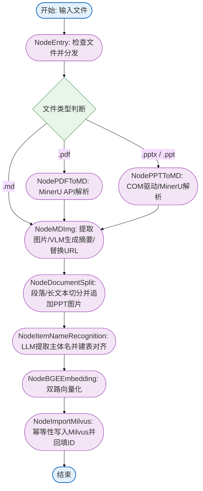
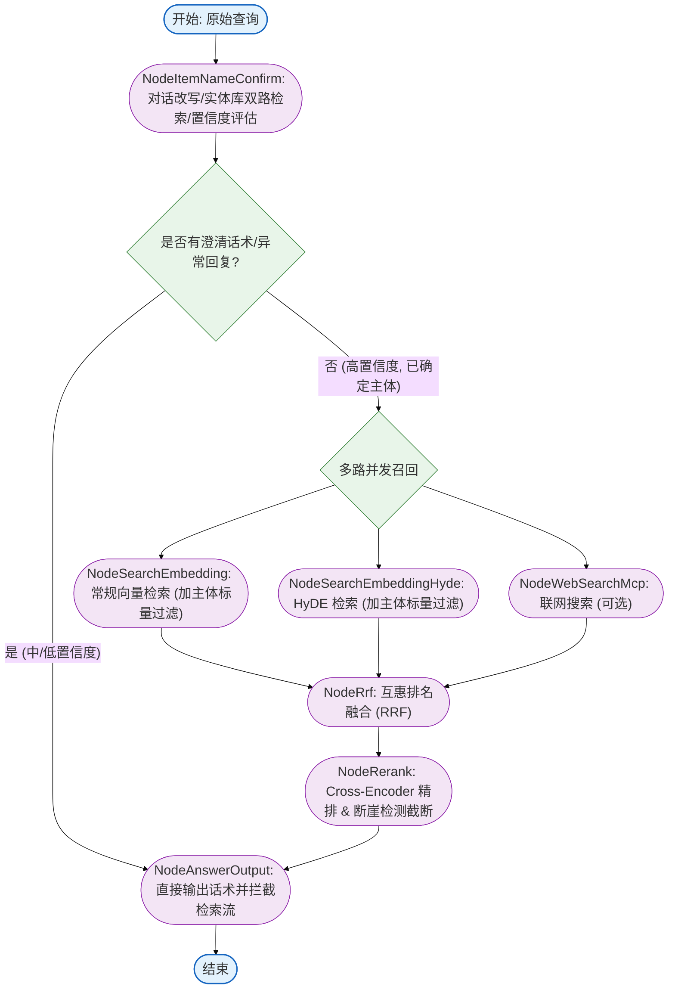

# RAG 与多模态文档解析主图深度解读与面试题集锦

本项目是一个完整的工业级 RAG（检索增强生成）与多模态文档解析系统，基于 **LangGraph** 实现了复杂的流控制。本文包含两大流程主图：**导入流主图（Import Flow Graph）** 与 **查询流主图（Query Flow Graph）**，并对关键工程细节、边界处理及系统架构缺陷进行紧凑的问答（QA）提炼。

---

## 一、 两大主图架构

### 1. 导入（ETL）流程主图 
导入流程负责将不同格式的商业文档（Markdown, PDF, PPTX）进行结构化解析、多模态图文对齐、长文本切分、主体提取，并最终双路向量化写入 Milvus。



---

### 2. 查询（RAG）流程主图 
查询流程实现多轮对话意图改写、层级化实体对齐消歧、并行多路召回（常规、HyDE、Web）、互惠排名融合（RRF）以及精排断崖截断。



---

## 二、 核心工程细节与高频面试 QA

### 1. 入库命名、幂等与重名处理

Q: 文档入库时采用什么方式命名与标识？
A: 节点读取本地文件路径，提取去除后缀的文件纯名称（`Path.stem`）作为 `file_title`。后续所有切片与实体均绑定该 `file_title`。
Source: [atguigu/import_process/nodes/node_entry.py](./atguigu/import_process/nodes/node_entry.py#L27-L32)

Q: 重复导入同一文档时，如何保证向量库写入的幂等性？
A: 插入 Milvus 前，节点对 `file_title` 进行字符转义防止注入。随后执行标量删除 `client.delete(collection, filter=f"file_title == '{file_title}'")` 清理旧数据，最后执行批量插入。
Source: [atguigu/import_process/nodes/node_import_milvus.py](./atguigu/import_process/nodes/node_import_milvus.py#L93-L100)

Q: 如果上传了不同目录但同名的文件，系统如何处理？存在什么设计缺陷？
A: 系统直接按照 `file_title` 物理删除旧数据。后导入的同名文档会静默覆盖先导入的文档向量切片。此外，本地落盘的 JSON 文件也会被覆写。该设计缺少全局唯一 ID（`doc_id`）与内容哈希（如 MD5/SHA256）校验机制。
Source: [atguigu/import_process/nodes/node_import_milvus.py](./atguigu/import_process/nodes/node_import_milvus.py#L94-L98)

Q: 主体名称对齐库（`item_name_collection`）如何保证幂等？
A: 提取主体并插入 Milvus 主体库前，执行相同的逻辑：依据 `file_title` 执行标量删除旧的主体映射记录，再写入新的主体向量数据。
Source: [atguigu/import_process/nodes/node_item_name_recognize.py](./atguigu/import_process/nodes/node_item_name_recognize.py#L161-L165)

---

### 2. 多模态解析与切片工程细节

Q: Markdown 中图片替换为 MinIO 线上 URL 时，如何避免坐标偏移导致替换错位？
A: 正则扫描出所有图片匹配项后，按 `match.span()` 起始坐标进行降序排序。程序从文本末尾向前倒序替换，防止前方字符串长度改变影响后续匹配区间。
Source: [atguigu/import_process/nodes/node_md_img.py](./atguigu/import_process/nodes/node_md_img.py#L236-L244)

Q: PPT 幻灯片递归切分时长文本丢失图片引用，如何处理？
A: 切分节点判断当前文档为 PPT 时，提取该幻灯片的图片标签。递归切分子块后，如果子块内未包含该图片标签，则在子块尾部强制追加该页幻灯片截图的 MinIO 引用。
Source: [atguigu/import_process/nodes/node_document_split.py](./atguigu/import_process/nodes/node_document_split.py#L154-L157)

Q: 文档切片时，如何保证 Markdown 表格与代码块的语义完整性？
A: 节点维护状态机识别围栏符号（```` ``` ```` 或 `~~~`），避免代码块内部的 `#` 字符被误判为章节标题。针对表格结构，系统识别 HTML `<table>` 与 Markdown `| --- |` 标记，对表格内容整体保留，不执行文本切碎。
Source: [atguigu/import_process/nodes/node_document_split.py](./atguigu/import_process/nodes/node_document_split.py#L86-L93) 与 [atguigu/import_process/nodes/node_document_split.py](./atguigu/import_process/nodes/node_document_split.py#L139-L148)

Q: 稀疏向量索引选用内积（IP）度量，如何保证与稠密向量余弦相似度（COSINE）刻度一致？
A: 节点在配置稀疏倒排索引时显式开启 `normalize: True`。数学上，L2 范数归一化后的向量内积严格等同于余弦相似度，将两路检索的分数空间统一在 $[-1, 1]$。
Source: [atguigu/import_process/nodes/node_import_milvus.py](./atguigu/import_process/nodes/node_import_milvus.py#L76-L82)

Q: 解析 PDF 依赖云端下载时，如何解决 Python 环境网络代理拦截或握手失败？
A: 节点实现双层退化下载策略。首选 Python 原生 `urllib3` 高速流式下载；遇到连接异常或 SSL 报错时，自动退化使用 `subprocess` 调用操作系统原生 `curl` 命令兜底完成下载。
Source: [atguigu/import_process/nodes/node_pdf_to_md.py](./atguigu/import_process/nodes/node_pdf_to_md.py#L59)

---

### 3. 查询流多轮消歧、融合与动态截断

Q: 用户输入口语化或指代模糊时，系统如何进行多轮消歧与置信度分流？
A: LLM 结合历史对话生成改写问题并提取主体名称。系统在 Milvus 主体库做双路向量检索计算相似度：得分 $\ge 0.85$ 判定为确定主体；得分在 $0.6 \sim 0.85$ 判定为歧义主体，生成澄清卡片；得分 $\le 0.6$ 输出无结果话术。
Source: [atguigu/query_process/nodes/node_item_name_confirm.py](./atguigu/query_process/nodes/node_item_name_confirm.py#L250-L290)

Q: 触发澄清提问时，如何在 LangGraph 中避免浪费向量检索与精排算力？
A: 主图在 `NodeItemNameConfirm` 之后挂载动态路由条件边 `after_item_name_confirm_router`。检测到状态中已填充 `answer` 字段时，直接短路跳转到 `NodeAnswerOutput` 输出响应，彻底拦截后续的 HyDE、向量检索、联网搜索与重排链路。
Source: [atguigu/query_process/main_graph.py](./atguigu/query_process/main_graph.py#L34-L41)

Q: 向量检索中为何必须执行主体标量过滤（Scalar Filtering）？
A: 同品类工业设备型号多且参数接近。不加过滤的向量检索容易召回相似型号产生幻觉。系统使用 `expr = "item_name in ['...']"` 强行将向量相似度计算约束在目标商品文档范围内。
Source: [atguigu/query_process/nodes/node_search_embedding.py](./atguigu/query_process/nodes/node_search_embedding.py#L55-L65)

Q: 常规向量检索、HyDE 检索与联网检索得分量纲不同，如何进行打分融合？
A: 节点采用互惠排名融合（RRF）算法。系统仅提取各路召回列表的相对位次 $Rank$，按公式 $RRF\_Score(d) = \sum \frac{w_m}{Rank_m(d) + 60}$ 累加得分，并借助字典实现 $O(1)$ 复杂度去重合并。
Source: [atguigu/query_process/nodes/node_rrf.py](./atguigu/query_process/nodes/node_rrf.py#L11-L26)

Q: 精排模型打分后，如何避免固定 Top-K 截断引入噪声或丢弃相关内容？
A: 节点采用动态断崖检测（Cliff Detection）。设定保留区间为 3 至 10 条。从第 3 条文档向后滑动比对相邻分差。若绝对分差超过 0.25 或相对降幅超过 10%，触发断崖截断，舍弃后续所有文档。
Source: [atguigu/query_process/nodes/node_rerank.py](./atguigu/query_process/nodes/node_rerank.py#L173-L194)

---

### 4. 项目真实缺陷与架构反思（实战评价）

Q: 从生产级后端标准来看，当前导入流在存储与状态管理上有哪些不合理之处？
A: 
1. **单机路径耦合**：节点中间数据强依赖本地文件系统（`OUTPUT_DIR / ...`），不支持分布式多实例部署；
2. **缺乏事务保证**：Milvus 采用“先标量删除、后批量插入”模拟更新。若插入阶段失败，旧切片已被删除，导致数据丢失且无法回滚；
3. **同名无哈希校验**：入库仅比对文件名，未校验文档 MD5/SHA256 哈希，同名不同内容文档相互覆盖；
4. **进程级锁局限**：创建 Collection 仅使用单机 `threading.Lock()`，无法防御跨容器并发创建冲突。
Source: [atguigu/import_process/nodes/node_import_milvus.py](./atguigu/import_process/nodes/node_import_milvus.py#L14-L15) 与 [atguigu/import_process/nodes/node_document_split.py](./atguigu/import_process/nodes/node_document_split.py#L174-L180)

Q: 从高可用与容错角度来看，当前查询流有哪些潜在风险？
A: 
1. **实体抽取单点失败**：大模型解析实体若输出格式异常或超时，缺乏规则回退兜底，导致主体检索直接返回空；
2. **并发检索无隔离熔断**：并行三路检索缺少超时熔断保护，单路（如网络搜索或 HyDE）延迟高会阻塞整个查询链路。
Source: [atguigu/query_process/nodes/node_item_name_confirm.py](./atguigu/query_process/nodes/node_item_name_confirm.py#L88-L100)
